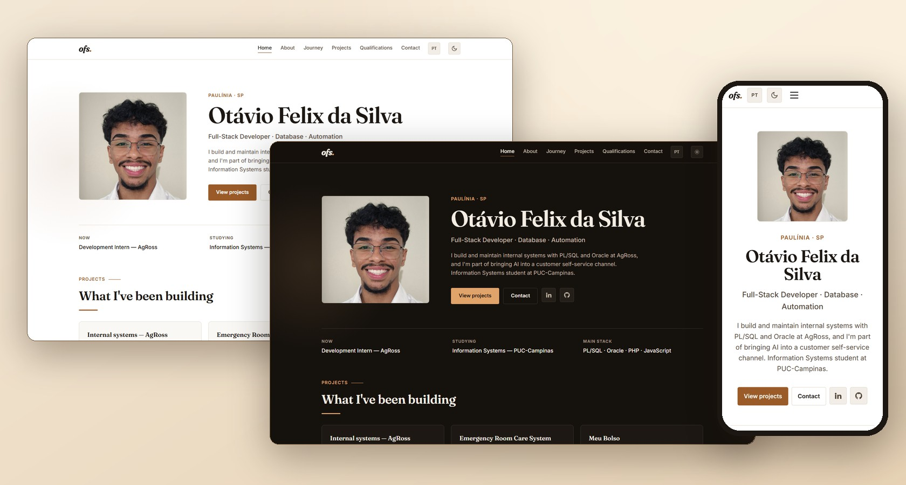

<div align="center">



<br>

[Português](README.md) &nbsp;·&nbsp; **English**

<br>


# site-pessoal

**Personal portfolio and living resume of Otávio Felix da Silva.**<br>Plain HTML, CSS and JavaScript. No framework, no build.

<br>

<a href="https://otaviofelix-in.github.io/site-pessoal/"></a>

<br>
<br>

     

<br>
<br>

[Home](https://otaviofelix-in.github.io/site-pessoal/) &nbsp;·&nbsp; [About](https://otaviofelix-in.github.io/site-pessoal/sobre.html) &nbsp;·&nbsp; [Journey](https://otaviofelix-in.github.io/site-pessoal/trajetoria.html) &nbsp;·&nbsp; [Projects](https://otaviofelix-in.github.io/site-pessoal/projetos.html) &nbsp;·&nbsp; [Qualifications](https://otaviofelix-in.github.io/site-pessoal/skills.html) &nbsp;·&nbsp; [Contact](https://otaviofelix-in.github.io/site-pessoal/contato.html)

<br>



</div>

<br>

---

## Why it exists

One link to paste into LinkedIn, the resume and GitHub: **who I am, what I've built and how to reach me**, always up to date, with no need to resend a PDF. The site itself is also a project, so the code is open here.

> The site opens in Portuguese. The **EN** button in the header switches the whole page to English.

## Pages

| Page | What's in it |
|---|---|
| **Home** | introduction, what I do now, featured projects, stack, a 30-second video and three journey milestones |
| **About** | who I am, real numbers (archive restructured, reach, courses), education, languages and technical foundation |
| **Journey** | timeline from 2022 to today, filterable between **professional** and **personal** milestones |
| **Projects** | internal systems at AgRoss, an emergency-room system, Meu Bolso and MaduTasks, with links to the code |
| **Qualifications** | stack by area and certificates, with institution, hours and the PDF of each one |
| **Contact** | email, LinkedIn, GitHub and resume as PDF (Portuguese and English) |

## Build details

- **Portuguese and English.** The button switches the page text, the tab title and the search description.
- **Light and dark theme**, both in the same brand; the choice is remembered in the browser.
- **Accessible.** AA contrast checked in both themes, visible focus, keyboard navigation, a "skip to content" link and `prefers-reduced-motion` support.
- **Works without JavaScript.** The content shows up even if the script fails.
- **Video on demand.** The YouTube iframe (`youtube-nocookie`) only loads on click.
- **Share preview.** Open Graph tags with absolute URLs and structured data (JSON-LD).
- **Phone number behind a click**, so it isn't exposed to spam bots.
- **Responsive.** Checked from 360 to 1280&nbsp;px, with no horizontal scroll.

## Design

One brand across both themes: beige and brown, with **one** accent. Hierarchy through weight and space, not decoration; a 4&nbsp;px spacing scale; no invented numbers or testimonials.

| | Light | Dark |
|---|---|---|
| Background |  `#ffffff` |  `#15110d` |
| Text |  `#1c1712` |  `#f4ede3` |
| Accent |  `#9a5b28` |  `#e0a36a` |
| Database |  `#0b6079` |  `#8fcfdc` |

**Typography:** [Fraunces](https://fonts.google.com/specimen/Fraunces) for headings and [Inter](https://fonts.google.com/specimen/Inter) for body text. The teal is reserved for anything database-related (SQL, PL/SQL, Oracle).

## Structure

```text
site-pessoal/
├── index.html           home
├── sobre.html           about
├── trajetoria.html      journey
├── projetos.html        projects
├── skills.html          qualifications
├── contato.html         contact
├── css/style.css        tokens (light/dark), components, responsive
├── js/main.js           theme, language, menu, video, filter, scroll reveal
└── assets/              photo, favicon, resumes and certificate PDFs
```

## Running locally

There's no build and no dependencies. Any static server works:

```bash
git clone https://github.com/OtavioFelix-in/site-pessoal.git
cd site-pessoal
python -m http.server 8000
# open http://localhost:8000
```

Opening `index.html` straight in the browser also works; the only difference is that the video opens on YouTube instead of being embedded (YouTube refuses embeds without an `http` origin).

## Publishing

The site is served by **GitHub Pages** from the `main` branch. A `git push` publishes it in about a minute.

<p align="center">
  
</p>

<br>

<div align="center">

**Otávio Felix da Silva** &nbsp;·&nbsp; Paulínia, SP, Brazil

[Email](mailto:otavio.felix433@gmail.com) &nbsp;·&nbsp; [LinkedIn](https://www.linkedin.com/in/otaviofelix) &nbsp;·&nbsp; [GitHub](https://github.com/OtavioFelix-in)

</div>
