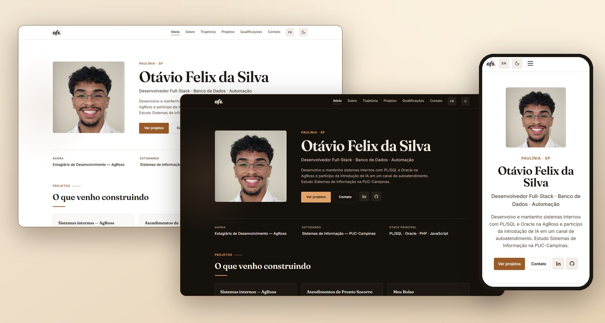

<div align="center">



<br>

**Português** &nbsp;·&nbsp; [English](README.en.md)

<br>


# site

**Portfólio e currículo vivo de Otávio Felix da Silva.**<br>HTML, CSS e JavaScript puros. Sem framework, sem build.

<br>

<a href="https://otaviofelix-in.github.io/site/"></a>

<br>
<br>

     

<br>
<br>

[Início](https://otaviofelix-in.github.io/site/) &nbsp;·&nbsp; [Sobre](https://otaviofelix-in.github.io/site/sobre.html) &nbsp;·&nbsp; [Trajetória](https://otaviofelix-in.github.io/site/trajetoria.html) &nbsp;·&nbsp; [Projetos](https://otaviofelix-in.github.io/site/projetos.html) &nbsp;·&nbsp; [Qualificações](https://otaviofelix-in.github.io/site/skills.html) &nbsp;·&nbsp; [Contato](https://otaviofelix-in.github.io/site/contato.html)

<br>



</div>

<br>

---

## Por que existe

Um link só para colar no LinkedIn, no currículo e no GitHub: **quem eu sou, o que já construí e como falar comigo**, sempre atualizado, sem precisar reenviar PDF. O próprio site também é um projeto, então o código fica aberto aqui.

## Páginas

| Página | O que tem |
|---|---|
| **Início** | apresentação, o que faço agora, projetos em destaque, stack, vídeo de 30 segundos e três marcos da trajetória |
| **Sobre** | quem sou, números reais (arquivo reestruturado, alcance, cursos), formação, idiomas e base técnica |
| **Trajetória** | linha do tempo de 2022 até hoje, com filtro entre marcos **profissionais** e **pessoais** |
| **Projetos** | sistemas internos na AgRoss, sistema de pronto socorro, Meu Bolso e Studify, com link para o código |
| **Qualificações** | stack por área e certificados, com instituição, carga horária e o PDF de cada um |
| **Contato** | e-mail, LinkedIn, GitHub e currículo em PDF (português e inglês) |

## Detalhes de construção

- **Português e inglês.** O botão troca o texto da página, o título da aba e a descrição para busca.
- **Tema claro e escuro**, os dois na mesma marca; a escolha fica lembrada no navegador.
- **Acessível.** Contraste AA conferido nos dois temas, foco visível, navegação por teclado, link "pular para o conteúdo" e respeito a `prefers-reduced-motion`.
- **Funciona sem JavaScript.** O conteúdo aparece mesmo se o script falhar.
- **Vídeo sob demanda.** O iframe do YouTube (`youtube-nocookie`) só carrega no clique.
- **Preview ao compartilhar.** Tags Open Graph com URLs absolutas e dados estruturados (JSON-LD).
- **Telefone sob clique**, para não ficar exposto a robôs de spam.
- **Responsivo.** Verificado de 360 a 1280&nbsp;px, sem rolagem horizontal.

## Design

Uma marca só, nos dois temas: bege e marrom, com **um** acento. Hierarquia por peso e espaço, não por enfeite; escala de espaçamento de 4&nbsp;px; nenhum número ou depoimento inventado.

| | Claro | Escuro |
|---|---|---|
| Fundo |  `#ffffff` |  `#15110d` |
| Texto |  `#1c1712` |  `#f4ede3` |
| Acento |  `#9a5b28` |  `#e0a36a` |
| Banco de dados |  `#0b6079` |  `#8fcfdc` |

**Tipografia:** [Fraunces](https://fonts.google.com/specimen/Fraunces) nos títulos e [Inter](https://fonts.google.com/specimen/Inter) no corpo. O azul-petróleo é reservado a tudo que é banco de dados (SQL, PL/SQL, Oracle).

## Estrutura

```text
site/
├── index.html           início
├── sobre.html
├── trajetoria.html
├── projetos.html
├── skills.html          qualificações
├── contato.html
├── css/style.css        tokens (claro/escuro), componentes, responsivo
├── js/main.js           tema, idioma, menu, vídeo, filtro, revelar ao rolar
└── assets/              foto, favicon, currículos e certificados em PDF
```

## Rodando localmente

Não há build nem dependências. Qualquer servidor estático serve:

```bash
git clone https://github.com/OtavioFelix-in/site.git
cd site
python -m http.server 8000
# abra http://localhost:8000
```

Abrir o `index.html` direto no navegador também funciona; a única diferença é que o vídeo abre no YouTube em vez de ficar embutido (o YouTube recusa embed sem origem `http`).

## Publicação

O site é servido pelo **GitHub Pages** a partir da branch `main`. Um `git push` publica em cerca de um minuto.

<p align="center">
  
</p>

<br>

<div align="center">

**Otávio Felix da Silva** &nbsp;·&nbsp; Paulínia, SP

[E-mail](mailto:otavio.felix433@gmail.com) &nbsp;·&nbsp; [LinkedIn](https://www.linkedin.com/in/otaviofelix) &nbsp;·&nbsp; [GitHub](https://github.com/OtavioFelix-in)

</div>
